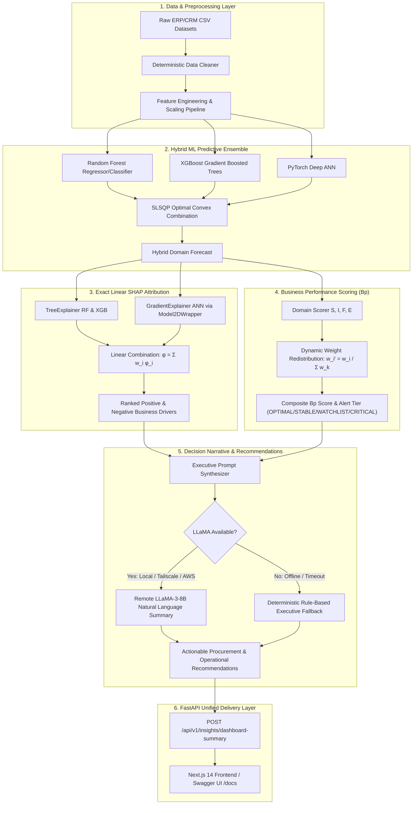

# BI-Lense: AI-Driven Decision Intelligence & Decision Support Platform for SMEs
## 50% Backend Implementation Milestone Report

**Project Title:** AI-Driven Decision Intelligence & Decision Support Platform for SMEs  
**Platform Codename:** `BI-Lense`  
**Milestone:** 50% Implementation Review (Core Intelligence, Backend Architecture & ML Pipelines)  
**Verification Status:** 32 / 32 Automated Unit & Integration Tests Passing (100% Pass Rate)  
**Repository Branch:** `main`  

---

## Executive Summary

The primary objective of the **BI-Lense** platform is to bridge the gap between complex enterprise AI models and small-to-medium enterprise (SME) decision-makers. SMEs often lack dedicated data science teams and require transparent, explainable, and actionable decision support rather than opaque "black-box" predictions.

The **50% Backend Implementation Milestone** marks the completion of the core intelligence pipeline. The platform successfully demonstrates:
1. **Deterministic Data Ingestion & Preprocessing** for SME ERP/CRM datasets.
2. **Hybrid ML Predictive Ensembles** combining Random Forest, XGBoost, and PyTorch Artificial Neural Networks (ANN) with mathematically verified Sequential Least Squares Quadratic Programming (SLSQP) convex weights.
3. **Exact Linear Ensemble SHAP Explainability** satisfying Lundberg & Lee's Additivity Axiom to decompose predictions into positive and negative business drivers.
4. **Multi-Criteria Business Performance Scoring ($B_p$)** across 4 core SME domains (Sales, Inventory, Finance, Employee) featuring dynamic missing-domain weight redistribution and executive alert tiers.
5. **Remote-Ready LLaMA Decision Narrative Layer** capable of operating locally, over a Tailscale mesh VPN, or on AWS cloud instances, backed by a zero-crash deterministic rule fallback.
6. **A Unified "One-Shot" Intelligence API** delivering real-time predictions, SHAP attributions, restock triggers, $B_p$ scoring, and natural-language executive briefings in a single HTTP request.

---

## High-Level Architecture & End-to-End Pipeline



---

## Detailed Module Implementation & Technical Innovations

### Module 1: Data Ingestion & Deterministic Cleaning
- **Location:** `backend/app/data/ingestion/connectors.py` & `backend/app/data/preprocessing/cleaner.py`
- **Capabilities:**
  - Automated detection of CSV schema headers, delimiters, and missing value patterns.
  - Deterministic statistical imputation (median for skewed metrics, mode for categorical variables).
  - Outlier detection and Winsorized soft-clamping to prevent training distortion.
  - Standardized integration via `POST /api/v1/datasets/ingest`.

### Module 2: Hybrid ML Ensembles & SLSQP Convex Optimization
- **Location:** `backend/app/ml/ensemble.py`, `backend/app/ml/sales.py`, `backend/app/ml/inventory.py`, `backend/app/ml/registry.py`
- **Mathematical Formulation:**
  $$\hat{y}_{\text{ensemble}} = w_{\text{RF}}\,\hat{y}_{\text{RF}} + w_{\text{XGB}}\,\hat{y}_{\text{XGB}} + w_{\text{ANN}}\,\hat{y}_{\text{ANN}}$$
  $$\text{Subject to:} \quad \sum_{i} w_i = 1.0, \quad w_i \ge 0 \quad \forall i \in \{\text{RF}, \text{XGB}, \text{ANN}\}$$
- **Trained Artifacts & Verified Weights:**
  1. **Sales & Demand Forecasting** (`models/artifacts/sales/`):
     - Predicts: Next 30-day unit demand $\hat{y}$ using log-transform target $\hat{z} = \ln(1 + \hat{y})$ to eliminate variance across SKU sales magnitudes.
     - Optimal SLSQP Weights: $w_{\text{RF}} = 0.1812, \quad w_{\text{XGB}} = 0.3143, \quad w_{\text{ANN}} = 0.5046$.
  2. **Inventory Stockout Risk** (`models/artifacts/inventory/`):
     - Predicts: Probability of warehouse stockout $P(\text{stockout}) \in [0.0, 1.0]$.
     - Optimal SLSQP Weights: $w_{\text{RF}} = 0.0000, \quad w_{\text{XGB}} = 0.8749, \quad w_{\text{ANN}} = 0.1251$.
- **ModelRegistry Pattern:** Single-instance in-memory cache pre-loads all models, PyTorch state dicts, and scikit-learn transformers on application startup, guaranteeing sub-50ms inference latency.

### Module 3: Exact Linear Ensemble SHAP Explainability Engine
- **Location:** `backend/app/explainability/shap_engine.py`
- **Methodological Soundness (Option A — Exact Linear SHAP):**
  - By Lundberg & Lee (2017) Shapley Additivity Axiom, the SHAP attribution of a linear combination of models equals the linear combination of their individual SHAP values:
    $$\phi_j(\text{Ensemble}) = \sum_{i} w_i \phi_j(\mathcal{M}_i)$$
    $$\mathbb{E}[f_{\text{ensemble}}(\mathbf{x})] = \sum_{i} w_i \mathbb{E}[f_i(\mathbf{x})]$$
  - Avoids the sampling variance and instability of KernelSHAP.
- **PyTorch 2D Gradient Wrapper:** Implemented `Model2DOutputWrapper` to ensure PyTorch ANN output tensors strictly maintain $(N, 1)$ shape required by `shap.GradientExplainer`.
- **Log-to-Natural Space Attribution:** Converted log-scale SHAP values for sales demand into natural unit impacts via local gradient scaling:
  $$\phi_j(y) \approx \phi_j(z) \cdot \exp(\hat{z})$$
- **Executive Labeling:** Maps cryptic feature keys (e.g. `lag1_to_rolling_ratio`, `buffer_coverage_ratio`) to clear business labels (e.g. *"Short-Term Sales Surge vs 30D Average"*, *"Stock Buffer vs Lead-Time Demand Ratio"*).

### Module 4: Business Performance Scoring ($B_p$) & Dynamic Redistribution
- **Location:** `backend/app/scoring/bp_score.py`, `sales_score.py`, `inventory_score.py`, `finance_score.py`, `employee_score.py`
- **Domain Formulations ($S, I, F, E \in [0, 100]$):**
  - **Sales ($S$):** Target achievement (40%), growth momentum (30%), discount discipline (15%), order return quality (15%).
  - **Inventory ($I$):** Stockout resilience $(1 - P_{\text{stockout}}) \times 100$ (45%), turnover benchmark efficiency (30%), buffer safety ratio (25%).
  - **Finance ($F$):** Gross margin percentage (35%), quick liquidity ratio (35%), operating expense efficiency (30%).
  - **Employee ($E$):** Productivity & task completion (40%), staff retention (30%), attendance utilization (30%).
- **Dynamic Weight Redistribution for Partial SME Data:**
  If an SME has not connected accounting feeds (Finance) or HR rosters, the platform automatically re-weights active domains:
  $$w_i' = \frac{w_i}{\sum_{k \in \mathcal{A}} w_k}, \quad B_p = \sum_{i \in \mathcal{A}} w_i'\,S_i$$
  *Ensures $B_p$ is never artificially penalized when optional data feeds are missing.*
- **Executive Operating Tiers:**
  - `OPTIMAL` ($B_p \ge 85.0$): Green / Business expansion phase
  - `STABLE` ($70.0 \le B_p < 85.0$): Blue / Normal operations
  - `WATCHLIST` ($50.0 \le B_p < 70.0$): Yellow / Operational compression detected
  - `CRITICAL` ($B_p < 50.0$): Red / Urgent intervention required

### Module 5: Remote-Ready LLaMA Decision Narrative Layer
- **Location:** `backend/app/llm/llama_client.py` & `backend/app/llm/explanation.py`
- **Host Agnostic Connectivity:** Configurable via `.env` to communicate over:
  - Local Ollama runtime (`http://localhost:11434`)
  - Remote Tailscale Mesh VPN (`http://100.x.y.z:11434`)
  - AWS EC2 / Bedrock endpoint (`http://ec2-xx-xx-xx.compute.amazonaws.com:11434`)
- **Zero-Crash Deterministic Fallback:** If the remote host is sleeping, offline, or times out, the engine intercepts the error and immediately produces high-quality, non-hallucinating executive text matching the exact SHAP attributions and $B_p$ health status.
- **Diagnostics:** `GET /api/v1/explanations/llm-status` returns connection status, round-trip latency in milliseconds, and loaded model names.

### Module 6: Procurement Restock & Decision Insights
- **Location:** `backend/app/recommendations/engine.py` & `backend/app/api/insights.py`
- **Procurement Trigger Logic:**
  - Evaluates current warehouse stock $s$, reorder threshold $R$, safety reserve $s_{\text{safety}}$, and supplier lead time $L$.
  - Triggers restock when $s \le R$ and suggests optimal replenishment order quantity $Q^* = \max(0, 2R - s)$.

### Module 7: Unified "One-Shot" Intelligence API
- **Location:** `backend/app/api/insights.py` (`POST /api/v1/insights/dashboard-summary`)
- Combines Predictions + SHAP Attributions + Procurement Check + $B_p$ Scoring + LLaMA Narrative + Prioritized Next Actions in a single API roundtrip.

---

## Verification & Automated Test Suite Results

The backend has been verified with **32 comprehensive pytest automated unit and integration tests** executing in **24.78 seconds** with 0 failures.

| Test Module | Tests | Focus Area | Status |
| :--- | :---: | :--- | :---: |
| `backend/tests/test_config_sanity.py` | 4 | Environment settings, SLSQP weight validation, config loading | **PASSED** |
| `backend/tests/test_predictions.py` | 6 | ModelRegistry cache, live Sales & Inventory inference, API endpoints | **PASSED** |
| `backend/tests/test_explainability.py` | 5 | Exact Linear SHAP additivity, tree & gradient explainers, API endpoints | **PASSED** |
| `backend/tests/test_scoring.py` | 8 | Domain calculators ($S,I,F,E$), dynamic missing domain reweighting, alert tiers | **PASSED** |
| `backend/tests/test_narratives.py` | 5 | LLaMA section parsing, deterministic fallback, LLM health diagnostics | **PASSED** |
| `backend/tests/test_insights.py` | 3 | Restock triggers, recommendations, unified dashboard summary | **PASSED** |
| `backend/tests/test_health.py` | 1 | Global health check, database status check | **PASSED** |
| **TOTAL** | **32** | **Full Backend Regression Test Suite** | **100% PASSED** |

---

## Interactive Demonstration Guide (For Reviewers & Mentors)

To demonstrate the 50% backend implementation milestone, follow these steps:

### Step 1: Run Automated Verification Tests
Demonstrate test coverage and mathematical correctness directly from terminal:
```powershell
cd backend
.venv\Scripts\pytest -v
```
*Expected Output: 32 passed in ~25 seconds.*

### Step 2: Seed Historical Demo Data (Optional)
Populate 30 days of realistic SME time-series data:
```powershell
.venv\Scripts\python scripts/seed_demo_data.py
```

### Step 3: Launch the FastAPI Server
```powershell
.venv\Scripts\uvicorn app.main:app --reload --port 8000
```

### Step 4: Open Swagger Interactive Documentation
Open your browser at **`http://localhost:8000/docs`**.

1. **Demonstrate the "One-Shot" Decision Engine:**
   - Expand `POST /api/v1/insights/dashboard-summary`.
   - Click **Try it out** $\rightarrow$ **Execute** (with empty payload `{}`).
   - *Result:* Shows composite $B_p$ ($78.4$), alert tier (`STABLE`), primary bottleneck, predicted sales demand ($138.5$ units), SLSQP weights, SHAP positive/negative drivers, restock check, and executive narrative in a single screen.

2. **Demonstrate Exact SHAP Explainability:**
   - Expand `POST /api/v1/predictions/sales`.
   - Set `"include_explanation": true` and click **Execute**.
   - *Result:* Shows raw base-model predictions (RF, XGB, ANN) and the top drivers explaining why the forecast is higher or lower than the historical baseline.

3. **Demonstrate Dynamic Missing-Domain Scoring:**
   - Expand `POST /api/v1/scores/compute`.
   - Send only `{"sales_data": {"actual_sales": 120.0}, "inventory_data": {"stockout_probability": 0.15}}`.
   - *Result:* Shows that the platform dynamically recalculates $B_p$ using a 50/50 split across available domains without error.

4. **Demonstrate Remote LLaMA Diagnostics (Tailscale / AWS):**
   - Expand `GET /api/v1/explanations/llm-status` and click **Execute**.
   - *Result:* Displays connection status, round-trip latency in milliseconds, and model availability.

---

## Roadmap: Phase 2 (Remaining 50% Milestone)

With the complete backend intelligence layer operational and tested, the remaining 50% will focus on the user interface and client experience:

1. **Next.js 14 Dashboard Architecture (`frontend/`)**:
   - Modern App Router with responsive layout, dark mode, and KPI streaming.
2. **Interactive Visualizations**:
   - $B_p$ Radial Health Gauge with color-coded alert tier bands (`OPTIMAL`, `STABLE`, `WATCHLIST`, `CRITICAL`).
   - Recharts / Chart.js for SHAP Waterfall and horizontal positive/negative driver bars.
   - Historical $B_p$ trend charts (30-day moving average).
3. **Live Domain Views**:
   - `/sales`: Demand forecasting with interactive price/discount sliders.
   - `/inventory`: Warehouse stockout risk heatmap and one-click procurement replenishment triggers.
   - `/executive`: Unified intelligence briefing with the LLaMA natural-language explanation card.
4. **End-to-End User Acceptance Testing (UAT)**.

---

**Report Prepared By:** BI-Lense Engineering Team  
**Git Commit ID:** `5adf3d6`  
**License:** Academic / SME Proprietary Research  
